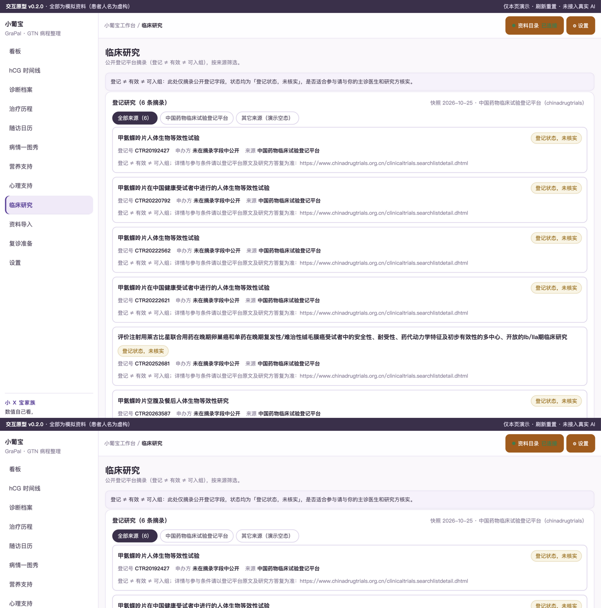

# 小葡宝 GraPal 妊娠滋养细胞肿瘤（GTN）工作台（品牌占位）

本机优先的 GTN 患者病程整理工作台：hCG 血清序列时间线（对数轴、无判读）、化疗疗程折叠卡档案、末次妊娠与 FIGO 评分自录整理、hCG 达正常锚点后随访日历与再生育记录、复诊准备。**不做诊断与治疗建议，不出任何判定性输出；0 访谈如实声明，患者原话均为改写占位句。**服务主体＝患者本人为主，照护者兼容（DEV-REQUIREMENTS）。

需求见 [BRIEF](docs/BRIEF.md)，规格见 [SPEC](docs/SPEC.md)，场景见 [SCENARIOS](docs/SCENARIOS.md)，交互合同见 [INTERACTION-DESIGN](docs/INTERACTION-DESIGN.md)，临床口径见 [CLINICAL-DATA](docs/CLINICAL-DATA.md)（NCCN GTN 2.2026 / FIGO 2000 / 中华医学会 2021）；先读 [AGENTS](AGENTS.md)。

## 关键功能（v0.2.0 原型实渲截图，演示数据、患者人名虚构）

### 看板（含 3D 指标分类卡）

「接下来」卡 + 指标分类 3D 翻转卡组 + 最近记录流；数值只陈述记录，不给判定。

### hCG 时间线

血 hCG 对数轴曲线（Fritsch–Carlson 平滑），平台期/反弹/达正常锚点事件由你勾选，工具不做判定。

### 治疗历程 折叠卡（收起态 / 展开态）

每疗一张折叠卡：收起看概要；

### 治疗历程 折叠卡 展开态

展开看详情与感受备注；「改这一条」更正不删除。

### 病情一图秀

清宫→hCG 序列→疗程→锚点→随访一张图讲完，事件均“你勾选/档案自述”口径。

### 随访日历

以你勾选的 hCG 达正常锚点为起点按月列记录入口，未到月置灰；出处可切换。

### 营养支持

化疗期每餐记录（AI 候选默认 + 手工收敛）、口腔溃疡期进食影响、体重序列；叶酸只按医嘱记录。

### 心理支持

情绪日记、“等报告日”单列记录（GTN 特异场景）、家庭沟通；私密记录仅本机。

### 临床研究

登记状态摘录（6 条，与 M4 四件套逐条一致）；登记 ≠ 有效 ≠ 可入组。

### 设置

患者资料目录、解析模式与凭据状态（不收集真实密钥）、临床参考数据包来源与版本。

## 怎么用

原型：直接打开 `public/index.html`（或 `python3 -m http.server` 后访问），全部为演示数据。
生产版（M5 后）：DSH Desktop 本地 tgz 安装，见 [RELEASE](docs/RELEASE.md)；首次使用先新建会话（宿主按会话授权）。

## 数据与口径

- 本机优先，患者数据不出本机；MinerU 云解析逐文件授权。
- 临床试验为登记状态摘录（research/gestational-trophoblastic，6 条，"未查过"通道如实记录）；登记 ≠ 有效 ≠ 可入组。
- 数据层无判读列（schema/0001 冻结 + check-schema 断言）；更正只新增版本不覆盖。

## 开发

```bash
node scripts/check-prototype.mjs   # 原型 HVT/IP 断言（20 项）
node scripts/check-schema.mjs      # schema 冻结 + 判读列断言
node scripts/fetch-gtn-trials-2026.mjs --dry-run  # 试验采集预演
npm run check                      # 装包合同静态检查
```

版本 v0.2.0 · 2026-10-25 · 小 X 宝家族。当前为原型阶段（M2），生产功能按 [DEV-PLAN](docs/DEV-PLAN.md) 推进。
