# 小葡宝 GraPal 妊娠滋养细胞肿瘤（GTN）工作台（品牌占位）

本机优先的 GTN 患者病程整理工作台：hCG 血清序列时间线（对数轴、无判读）、化疗疗程折叠卡档案、末次妊娠与 FIGO 评分自录整理、hCG 达正常锚点后随访日历与再生育记录、复诊准备。**不做诊断与治疗建议，不出任何判定性输出；0 访谈如实声明，患者原话均为改写占位句。**服务主体＝患者本人为主，照护者兼容（DEV-REQUIREMENTS）。

需求见 [BRIEF](docs/BRIEF.md)，规格见 [SPEC](docs/SPEC.md)，场景见 [SCENARIOS](docs/SCENARIOS.md)，交互合同见 [INTERACTION-DESIGN](docs/INTERACTION-DESIGN.md)，临床口径见 [CLINICAL-DATA](docs/CLINICAL-DATA.md)（NCCN GTN 2.2026 / FIGO 2000 / 中华医学会 2021）；先读 [AGENTS](AGENTS.md)。

<details>
<summary><b>? 疾病概要</b>（定义 · 规范与指南 · 治疗全景 · 发展趋势；看板右上 ? 图标点击可见同款弹窗）</summary>

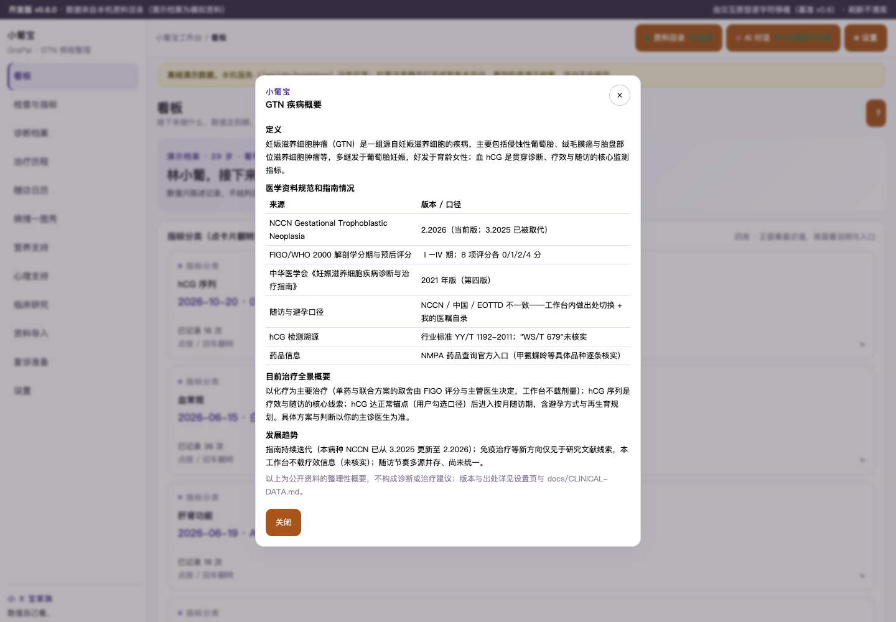

**定义**：妊娠滋养细胞肿瘤（GTN）是一组源自妊娠滋养细胞的疾病，主要包括侵蚀性葡萄胎、绒毛膜癌与胎盘部位滋养细胞肿瘤等，多继发于葡萄胎妊娠，好发于育龄女性；血 hCG 是贯穿诊断、疗效与随访的核心监测指标。

**医学资料规范和指南情况**：NCCN Gestational Trophoblastic Neoplasia **2.2026**（当前版，3.2025 已被取代）；FIGO/WHO 2000 解剖学分期（Ⅰ–Ⅳ）与预后评分（8 项各 0/1/2/4 分）；中华医学会《妊娠滋养细胞疾病诊断与治疗指南（2021 年版·第四版）》；随访与避孕口径 NCCN/中国/EOTTD 不一致（工作台内出处切换）；hCG 检测溯源 YY/T 1192-2011（"WS/T 679"未核实）；NMPA 药品查询官方入口。

**目前治疗全景概要**：以化疗为主要治疗（单药/联合取舍由 FIGO 评分与主管医生决定，工作台不载剂量）；hCG 序列是疗效与随访的核心线索；hCG 达正常锚点（用户勾选口径）后进入按月随访期，含避孕与再生育规划。具体方案与判断以你的主诊医生为准。

**发展趋势**：指南持续迭代（NCCN 3.2025→2.2026）；免疫治疗等新方向仅见于研究文献线索，本工作台不载疗效信息（未核实）；随访节奏多源并存、尚未统一。

以上为公开资料的整理性概要，不构成诊断或治疗建议；版本与出处详见 [CLINICAL-DATA](docs/CLINICAL-DATA.md)。
</details>

## 关键功能（v0.2.0 原型实渲截图，演示数据、患者人名虚构）

### 看板（含 3D 指标分类卡）
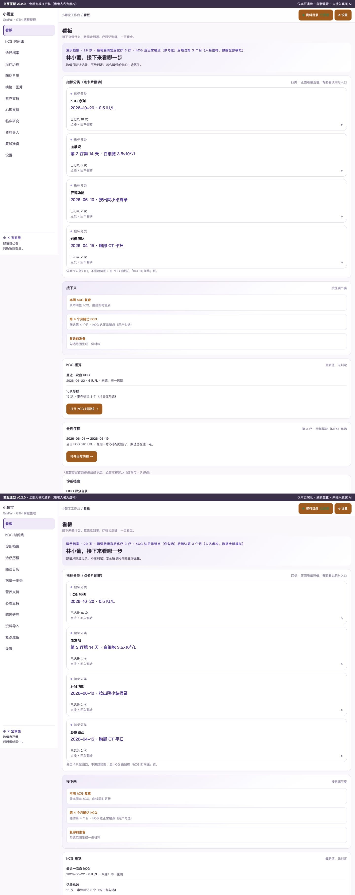
「接下来」卡 + 指标分类 3D 翻转卡组 + 最近记录流；数值只陈述记录，不给判定。

### hCG 时间线
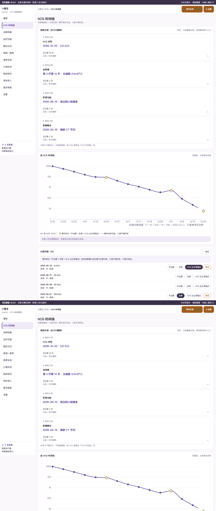
血 hCG 对数轴曲线（Fritsch–Carlson 平滑），平台期/反弹/达正常锚点事件由你勾选，工具不做判定。

### 治疗历程 折叠卡（收起态 / 展开态）
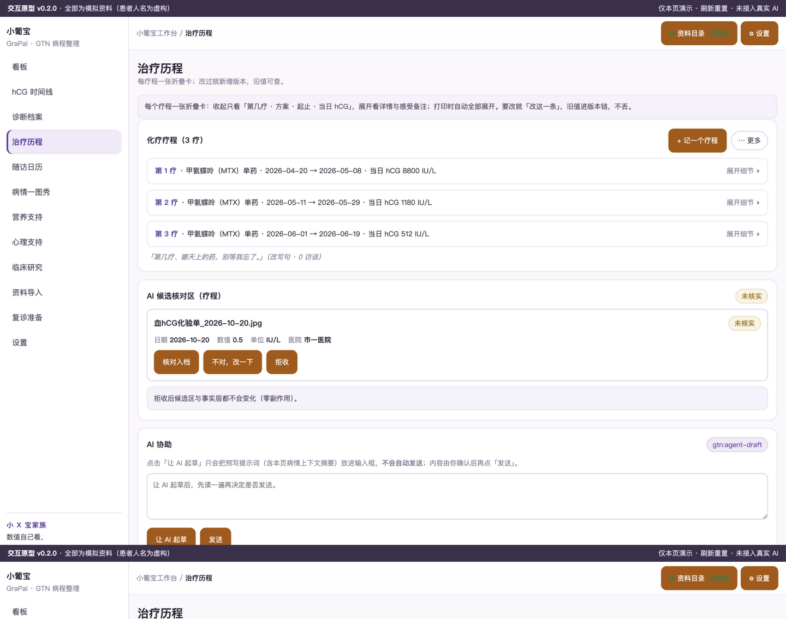
每疗一张折叠卡：收起看概要；

### 治疗历程 折叠卡 展开态
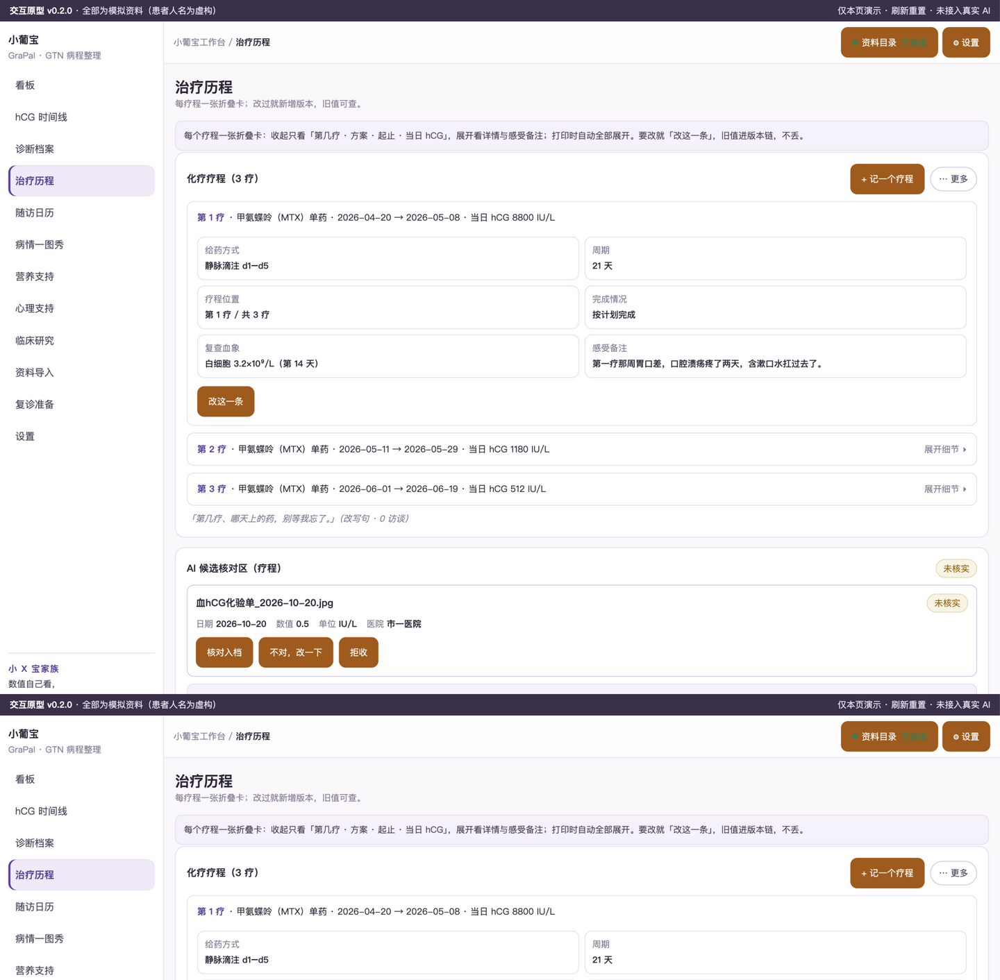
展开看详情与感受备注；「改这一条」更正不删除。

### 病情一图秀

清宫→hCG 序列→疗程→锚点→随访一张图讲完，事件均“你勾选/档案自述”口径。

### 随访日历
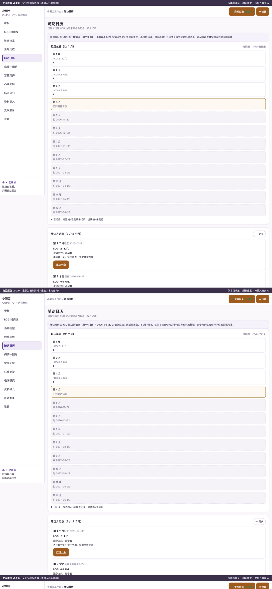
以你勾选的 hCG 达正常锚点为起点按月列记录入口，未到月置灰；出处可切换。

### 营养支持
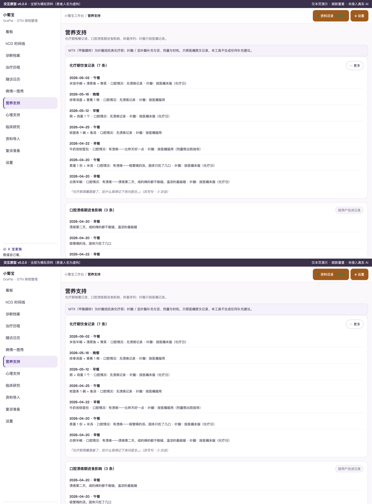
化疗期每餐记录（AI 候选默认 + 手工收敛）、口腔溃疡期进食影响、体重序列；叶酸只按医嘱记录。

### 心理支持
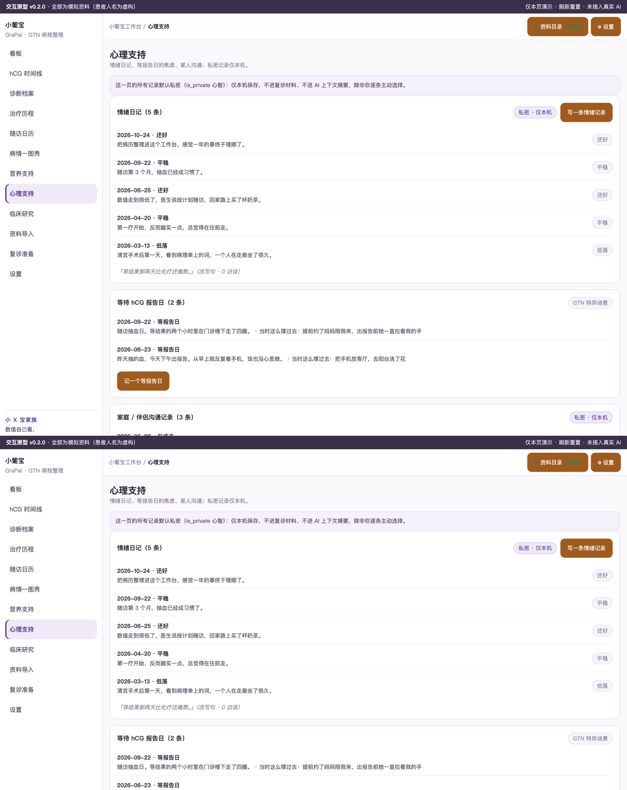
情绪日记、“等报告日”单列记录（GTN 特异场景）、家庭沟通；私密记录仅本机。

### 临床研究 · 三档匹配（MATCHING-SPEC 模式）
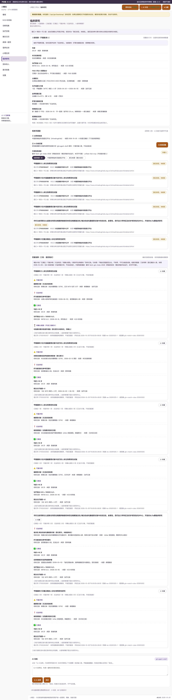
个人入组档案（不重复录入，完整度 8/10）→ 自带 sqlite 检索 + AI 协助起草（不代发）→ 三档结果卡（已满足/可能冲突/无法判定，缺失永远无法判定）；不给匹配百分比、不排序推荐；登记 ≠ 有效 ≠ 可入组。

### 设置
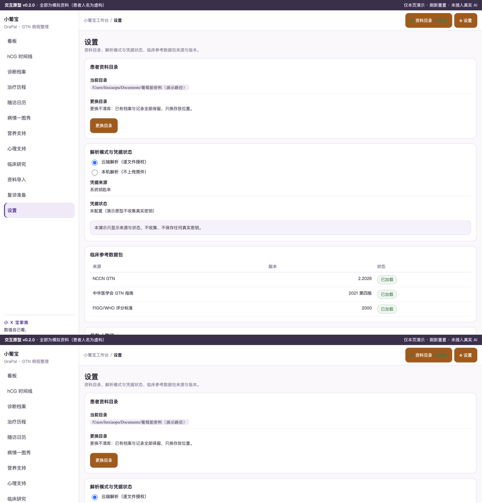
患者资料目录、解析模式与凭据状态（不收集真实密钥）、临床参考数据包来源与版本。


### 检查与指标 · 多系列趋势（v0.5.0）
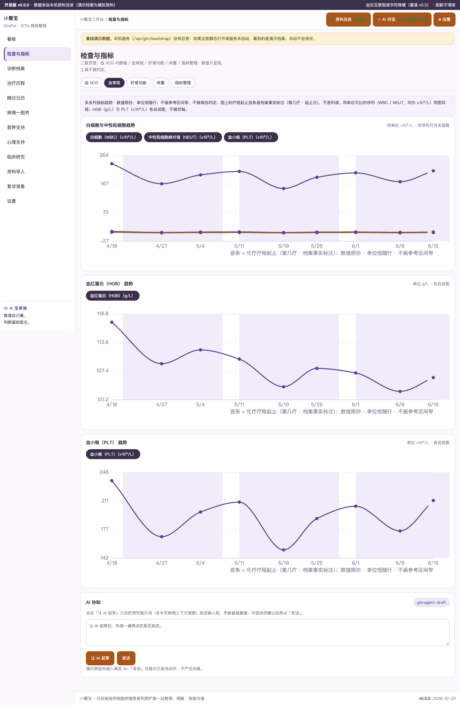
"检查与指标"二级页签（血 hCG / 血常规 / 肝肾功能 / 体重 / 指标管理）：WBC+NEUT 同图双线、HGB/PLT 各自成图、ALT+AST 双线、疗程起止以中性竖条标注（档案事实，非判读）；数值照抄、无参考区间带、无高低判定。

### 指标管理 · 序列动态呈现
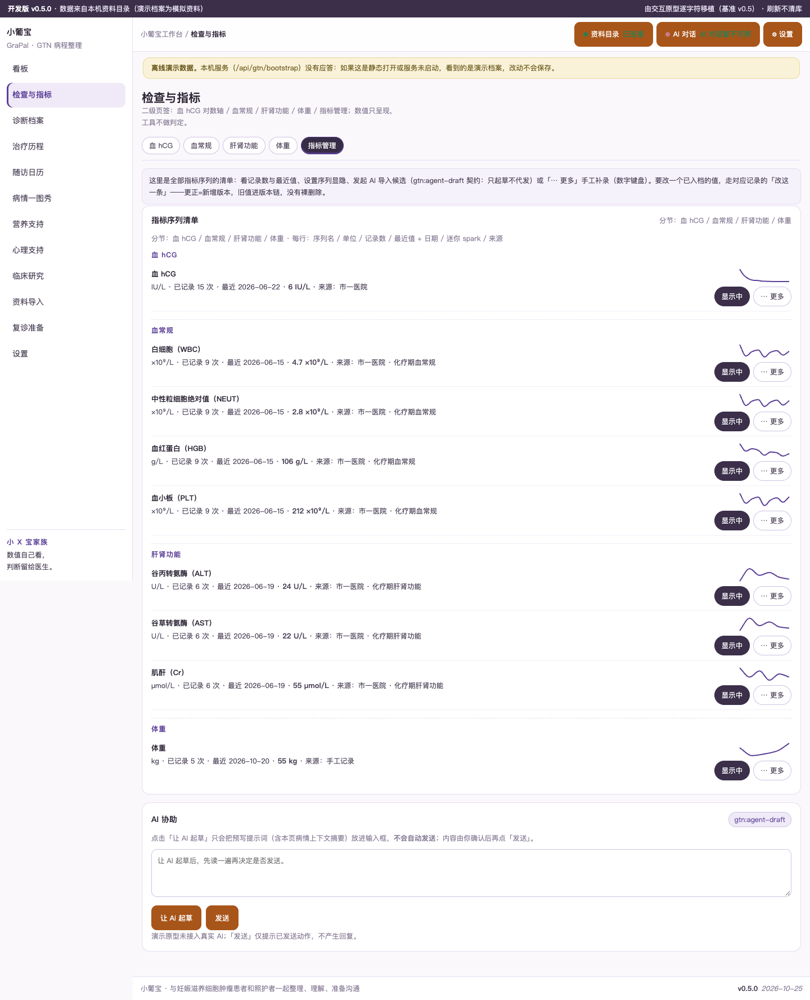
全部指标序列清单：序列名/单位/记录数/最近值+日期/迷你走势/来源，序列显隐设置、AI 导入候选（不代发）、「⋯ 更多」手工补录；更正=版本链。


### 和 AI 讨论（v0.7.0，每页标配）
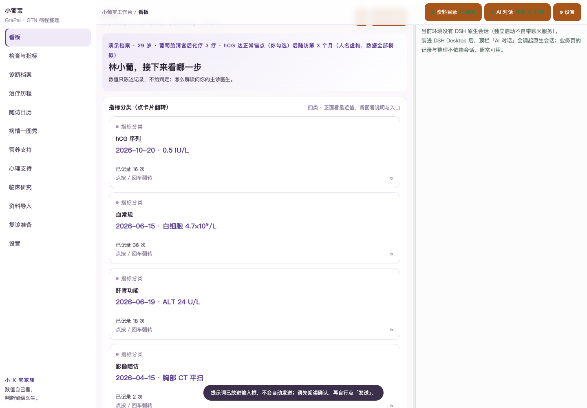
每页标题行「和 AI 讨论」按钮：点击拉起 AI 对话栏并携带本页关键信息（最近 hCG/疗程/随访月等事实摘要）进输入框——只填不发，确认后由你点「发送」（IP10 守卫）；顶栏五态开关负责随时拉起/隐藏对话栏；疾病概要弹窗内置「和 AI 讨论这个概要」。


### 一图秀 · rail 式多指标趋势（v0.8.0，对齐乳腺癌风格）
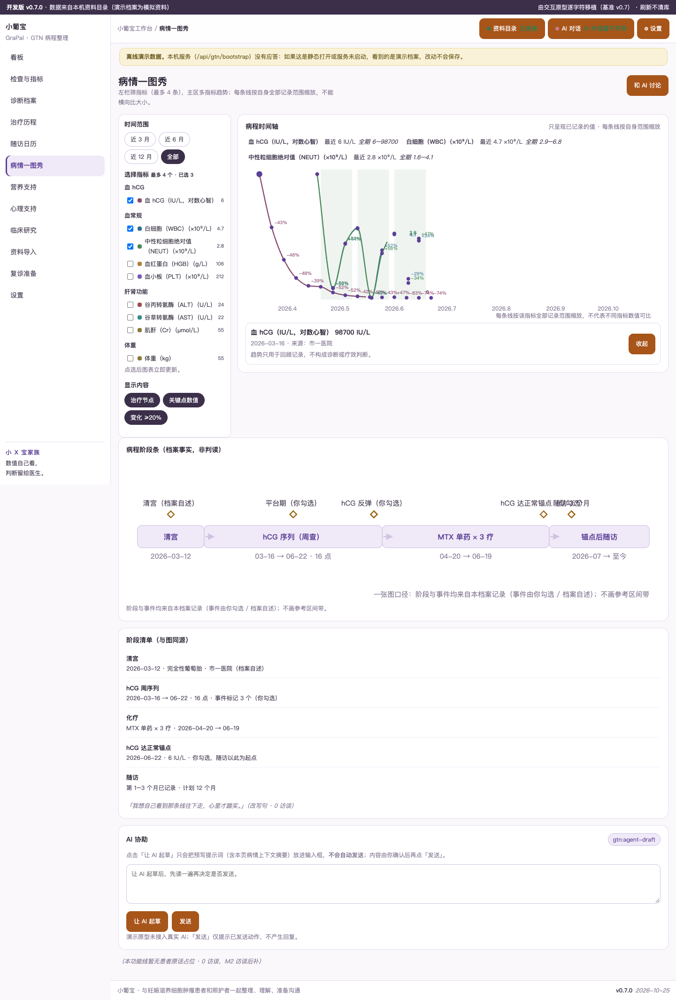
左栏：时间范围 chips + 分组指标勾选（≤4，即时更新）+ 显示开关；每条线按自身全部记录范围缩放；图例带全期区间；点选记录点 pin 数值/日期/来源；疗程色带为档案事实标注。

### 临床研究 · 分层命中三子页（35 号，参考 biliary-tract 结构）
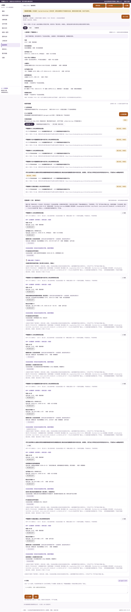
匹配（结构化/文本/宽口径命中分层陈列条件原文+你的记录+来源；无法自动匹配逐条列原因）/ 检索（筛条件与"与我相关"分开）/ 收藏跟踪（跟踪"试验变了什么"）；无数值综合分；snapshotDate 与通道终态透传；登记 ≠ 有效 ≠ 可入组。

## 怎么用

原型：直接打开 `public/index.html`（或 `python3 -m http.server` 后访问），全部为演示数据。
生产版（M5 后）：DSH Desktop 本地 tgz 安装，见 [RELEASE](docs/RELEASE.md)；首次使用先新建会话（宿主按会话授权）。

## 数据与口径

- 本机优先，患者数据不出本机；MinerU 云解析逐文件授权。
- 临床试验为登记状态摘录（research/gestational-trophoblastic，6 条，"未查过"通道如实记录）；登记 ≠ 有效 ≠ 可入组。
- 数据层无判读列（schema/0001 冻结 + check-schema 断言）；更正只新增版本不覆盖。

## 开发

```bash
node scripts/check-prototype.mjs   # 原型 HVT/IP 断言（20 项）
node scripts/check-schema.mjs      # schema 冻结 + 判读列断言
node scripts/fetch-gtn-trials-2026.mjs --dry-run  # 试验采集预演
npm run check                      # 装包合同静态检查
```

版本 v0.9.0 · 2026-10-25 · 小 X 宝家族。当前为原型阶段（M2），生产功能按 [DEV-PLAN](docs/DEV-PLAN.md) 推进。
